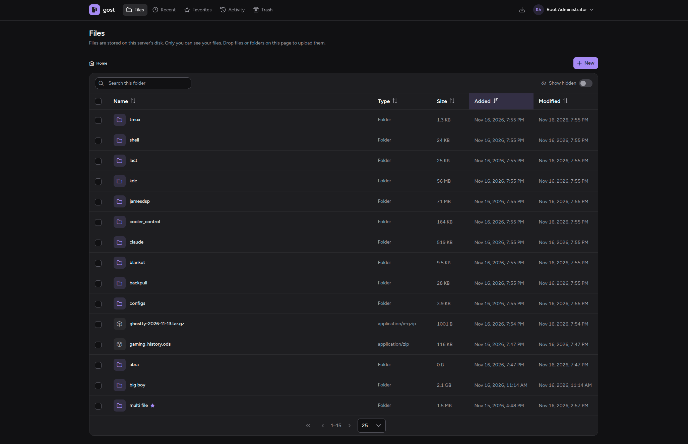

# Gost

A simple and lean self-hosted file host.
Built as an alternative to Nextcloud, for those who want to keep their files on their own server while retaining a minimal UI. You upload documents, pictures and videos, keep them in folders, and open them in the browser.
No calendar, no office suite, no app store. Just a file host behind a login.



## Hosting

The app can currently only be self-hosted with [Docker](./docs/docker.md).

## Local development

The instructions below are for anyone that wants to run the app locally.

### Requirements

- Go >= 1.27
- Node >= 22.12 and pnpm
- PostgreSQL
- Redis
- Docker (`make run` starts the observability stack with Docker Compose)

### Getting started

Create the configuration files from their examples and edit them

- `./.env.example` -> `./.env`
- `./client/.env.example` -> `./client/.env` (optional, defaults work for local dev)

Run the migrations and seeders, then start the server and the client

```sh
make migrate-up
make seed
make run
cd client && pnpm install && pnpm run dev
```

By default, the app will be available at http://localhost:3030.
Log in with the root user from `.env` (`SEED_ROOT_USER` and `SEED_ROOT_PASSWORD`).

See [docs/development.md](./docs/development.md) for tests, linting and releases.
